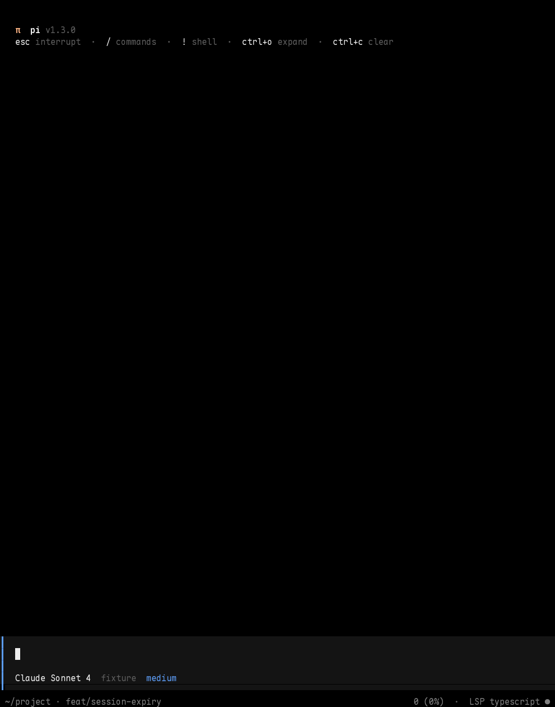
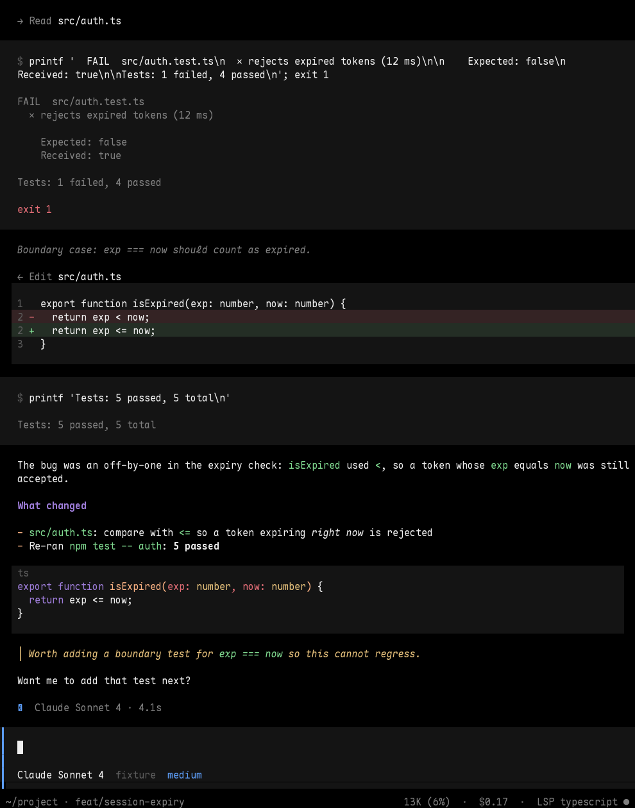
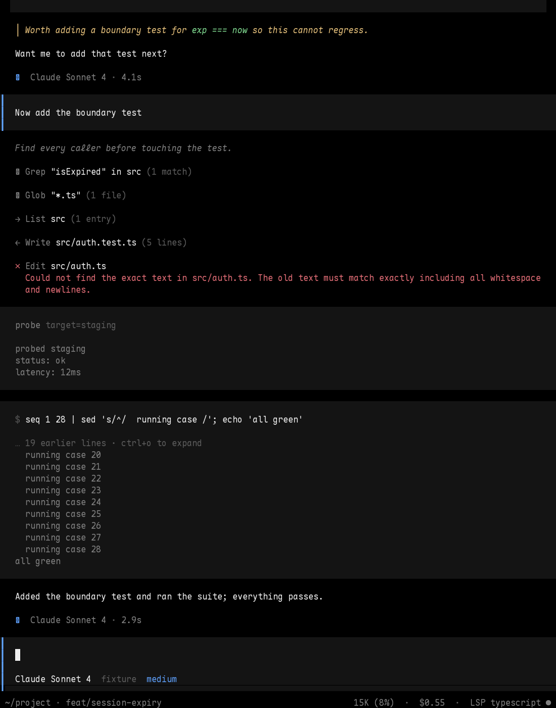

# Pi UI

`local.pi.ui` owns how Pi looks. Two interchangeable skins exist; only one may own the prompt, footer and tool renderers:

| `local.pi.ui.style` | Owner | Look |
|---|---|---|
| `opencode` (default) | local `dotfiles/pi/extensions/opencode-ui.ts` | OpenCode's: a left-bar prompt panel, a one-row footer, inline tool lines, filled bash and diff blocks |
| `omp` | pinned `@nguyenquangthai/pi-omp-theme` | omp's: rounded boxed prompt with a powerline status row, framed tool cards |

Both use the neutral-default-foreground adapter, and both replace Zentui, the local workspace header/footer, `managed-opencode` and `zentui.json`; AST and web-access capabilities stay independent. Set `local.pi.ui.style = "omp"` to go back to the previous look with no other change.

## Configuration

```nix
local.pi.ui = {
  enable = true;
  style = "opencode"; # or "omp"
  theme = "opencode"; # "omp-reference" for the omp skin; also "omp-dark", "terminal", "terminal-tinted"
  terminalThemes.enable = true;
  neutralForeground.enable = true;
  settings = { }; # omp skin only: recursively merged over managed piOmpTheme defaults
};
```

## OpenCode skin





Every column below is measured against one text column, 3, so prose, user messages, tool lines and code line up.

- **Prompt panel.** A heavy blue bar on every row, a `#141414` fill, two columns of padding, the model row (`Claude Sonnet 4  provider  high`, thinking level in its own colour) and a half-block edge (`╹▀▀▀`) so the fill ends mid-row. `!` and `!!` swap the model row for `shell`. Slash/`@` completion opens below the edge. Ghost text paints inside the panel unchanged.
- **Footer.** One row: path, branch and a `±N` count of changed paths (probed after tools that can write, never on a timer) on the left; `esc interrupt` while running, a role badge when the role is not `default` (`plan`, `slow`), context use, cost and the remaining extension statuses on the right. Statuses of constant capabilities (`ast-grep RW`) are dropped and the `model-roles` route text is reduced to the badge, since the model is already in the prompt panel. When the row is too narrow the statuses go first, then cost, and the path is cut last.
- **Working row.** While the agent runs, Pi's `Working` row names what is happening and, past three seconds, for how long: `Reading src/auth.ts`, `Running nix build .#checks · 1m 12s`, `Searching isExpired`. Calls another tool made (codemode, eval) do not take the row over.
- **Header.** `π pi vX` and the key hints, replacing Pi's startup block.
- **User messages.** The same bar and fill, two columns inside the text column.
- **Answers.** Indented to the text column. Fenced code becomes a filled block with a muted language label instead of visible fences. A finished answer (no tool calls) ends with `▣ model · 4.2s`, with `· interrupted` or `· switched from provider/model` when that applies, and `· ✎ 2 files +12 −3` when the turn changed files with `edit` or `write` (a file edited twice counts once, a failed edit not at all, a `write` or a heredoc written through `bash` counts as added lines). Only `write` and `edit` also show a diff, run the formatter and report diagnostics, so the managed `AGENTS.md` tells the model to use them instead of `cat > file <<EOF`. This replaces `model-hint.ts` for this skin (`pi.nix` leaves the hint out), because the hint added a line after every tool turn.
- **Tools.** `read`, `ls`, `grep`, `find`, `write` and `todo` are single lines (`→ Read src/a.ts [offset=5]`, `✱ Grep "x" in src (3 matches)`, `◈ Todo done #2`); the count comes from the tool's own details when it reports one (hashline's `grep`) and from the printed lines otherwise, and the todo list itself is the checklist above the prompt, so its result is not repeated. `edit` is a header plus a diff block with a line-number gutter, tinted `+`/`-` rows and **syntax colours** from Pi's own highlighter (the old and the new side highlighted as separate listings so multi-line constructs stay intact, restarted after a gap; the theme's text colour is reopened after every reset so no character falls back to the terminal foreground), folded to 18 rows with `ctrl+o` to expand. `bash` is one panel: `$ command` coloured as shell, with any heredoc body coloured as the language of the file it is written to (`cat > main.go <<'E'` is Go; `python3 - <<'PY'` is Python), a dim `↳ rtk ls -la` line when a hook rewrote the command so the panel shows both what the model asked for and what ran (no `↳` line means nothing was rewritten), the output tail (10 lines, `… N earlier lines · ctrl+o to expand`), `exit N` in red on failure, the duration past one second. Failures show the error text, wrapped. Tools from any other extension keep their own renderers but sit in the same panel.
- **Todo checklist.** While a `todo` list has open work it is a panel above the prompt (`✓` done, `●` in progress, `○` pending, `✗` blocked with its reason), folded to seven rows with the task in progress kept in view; it disappears when the list is finished. In RPC mode the one-line footer status is used instead.
- **Theme.** `opencode.json` follows OpenCode's palette (`#fab283` primary, `#5c9cf5` bar, `#9d7cd8` headings and keywords, `#7fd88f` strings and code, `#e06c75`/`#f5a742`/`#e5c07b` for variables, numbers, types). The diff tints are computed from the theme with `mixColors`, so a different theme gets matching tints.

### How it hooks in

Editor, footer, header and tool renderers use Pi's public API (`setEditorComponent`, `setFooter`, `setHeader`, `registerToolRenderer`, `renderShell: "self"`). The transcript has no hook for user and assistant messages, so `UserMessageComponent.render` and `AssistantMessageComponent.render` are wrapped through their exported prototypes, as `neutral-foreground.ts` does for `Markdown`. The wrapper is shared by every in-process session, restored when the last one stops, does nothing outside TUI mode, and reads the live theme. Both patches need review on a Pi upgrade. A renderer that throws prints a one-line `render failed: …` instead of vanishing.

Colours that are not themed would fall back to the terminal's default foreground (Mona Lisa yellow here), so every block sets its text colour explicitly and `pi-ui-opencode` fails if any visible text is left in the default.

### Previewing

`just pi-preview` builds the scripted-session check and links its captures at `/tmp/pi-ui` (PNGs for looking, `.txt` and `.ansi` for diffing); the commands below run the preview by hand against any settings file.

`tests/pi/ui-preview/preview.py` runs the real `pi` in a PTY against a scripted provider and writes `.txt`, `.ansi` and `.png` captures for startup, a working turn, a two-turn session with every tool, the slash menu, composing, and a narrow width. Run it outside the sandbox with any settings file:

```sh
nix-shell -p 'python3.withPackages (p: [p.pyte p.pillow])' git --run \
  "python3 tests/pi/ui-preview/preview.py --pi $(command -v pi) --settings settings.json --out /tmp/ui --rows 60 --check"
cat /tmp/ui/06-turn2.ansi   # the same screen with colour, in a terminal
```

`--check` asserts the skin's contract and is what the sandbox check runs.

## omp skin (`style = "omp"`)

The rest of this page, up to "Verification", describes the omp skin.

The omp palettes: `omp-reference` samples the supplied omp screenshot (cyan keywords, green functions, gold variables). `omp-dark` ports stock omp dark. Both are strict Pi truecolor themes. The optional JSON-only `pi-terminal-theme` supplies palette-following alternatives; `terminal-tinted` assumes custom terminal palette slots, so is not the default. Select a theme temporarily in Pi's `/settings`; change `local.pi.ui.theme` for a managed default.

The managed configuration disables automatic theme selection, OSC background synchronization, startup presentation, and read-only tool replacement. It selects an independent primary model/path/git/cost/context row, a boxed rounded prompt, and a secondary extension-status row. AST reports `ast-grep RO`; concise LSP and role labels must keep the **entire aggregate** within the terminal width. Upstream omits an oversized aggregate rather than wrapping individual statuses. Three short statuses are tested at 120 and 80 columns; 40-column rendering is exercised, not guaranteed to show every status.

### Rounded boxed frame exception

Upstream 1.0.26's `StyledEditor.frameKind()` gives `style = boxed` precedence over `frame = rounded`, rendering thick rules. The named one-line package patch makes explicit rounded frames work with boxed style. Documented presets do not avoid this conflict: rounded dock hosts its own primary status (duplicating the standalone row), and border placement hides the secondary statuses. Boxed remains the configured style so it does not host a duplicate status. Re-test and drop the patch when upstream honors this combination.

A second named patch translates `StyledEditor.handleMouse()` coordinates past the prompt, padding and rounded side border before delegating to native hit testing. Without it, clicking a text column selects the wrong cursor position. The existing real-PTY `abcXdef` click test covers this cutover regression; remove the patch once upstream handles its own rendered geometry.
## Settings and compatibility

Normal loading, two `/reload` calls, `/new`, and model turns leave the installed `settings.json` byte-identical. `settings.json` is a writable copy that each switch resets, so `/pi-omp-theme persist ...` works but lasts only until the next switch; persist desired values in Nix.

The visual owner's rich tool/message styling uses guarded private host adapters. The neutral adapter wraps exported `Markdown.render` and `CustomEditor.render` because Pi 1.3.0 has no public default-foreground hook. It preserves explicit foregrounds, reopens theme text after resets, reads the live theme, is idempotent across factory calls, restores owned methods on shutdown, and does nothing outside TUI mode. Both need review on Pi upgrades. Native highlight.js remains in use: no Shiki/TextMate engine, semantic LSP coloring, or runtime grammar downloads are added.

## Verification

```sh
rtk nix eval .#homeConfigurations.cachyos-framework13.activationPackage.drvPath
rtk nix build --no-link .#checks.x86_64-linux.pi-ui .#checks.x86_64-linux.pi-ui-opencode
```

`pi-ui` loads the three palettes through Pi's strict loader and runs the unit tests (core helpers, the wrapper's lifecycle, every tool renderer, the foreground adapter). `pi-ui-opencode` drives real Pi in a PTY with the managed opencode settings and fails on any missing surface or default-foreground text; its PNGs are the record. The omp contract and PTY checks (`pi-capabilities-contract`, `pi-capabilities-ui`) build the same configuration with `style = "omp"`.

The sandbox check validates both palettes through Pi's strict loader; tests adapter lifecycle/ANSI behavior; drives real Pi with generated settings and a local scripted provider through read/edit/native question/Tuios flows, Unicode/CJK/emoji paste/mouse/resize/reload/new; and checks print/JSON/RPC runs for empty stderr. No real model is called. The checked screenshot is `docs/assets/pi-omp-parity/ui.png`.

The screenshot was captured with `/tmp/pi-lab/lab.py` from the check's generated agent directory (managed settings/web-policy symlinks copied into a writable throwaway parent), using three local scripted provider requests. LSP/role status values in this UI-only screenshot are fixture labels, not proof that those separate integrations ran; AST is the actual managed extension.
